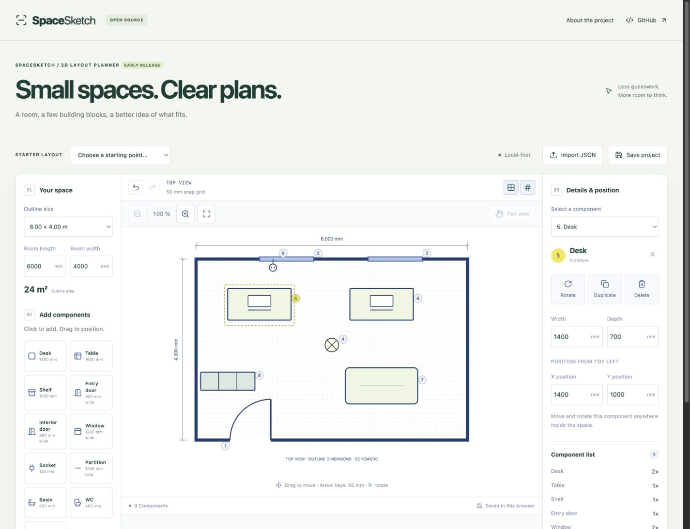
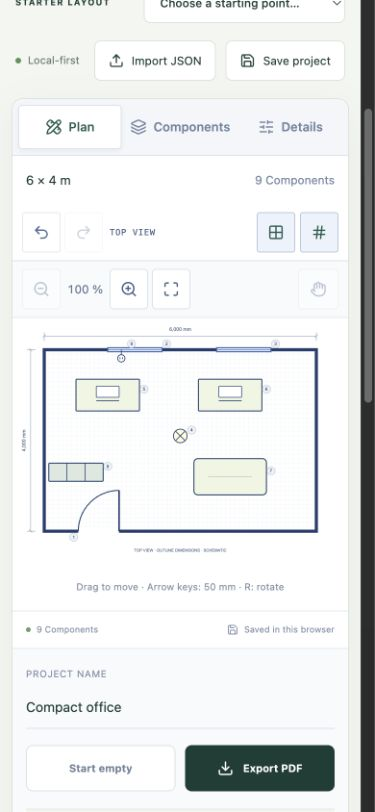

<div align="center">

# SpaceSketch

### Small spaces. Clear plans.

An adaptable, local-first **2D space planner** built with React, TypeScript and SVG.
Sketch a room, arrange components and take your idea with you.

[**Try the live demo →**](https://mduransu-maker.github.io/spacesketch/) · [Quick start](#quick-start) · [Adapt it](#make-it-your-own) · [Contribute](CONTRIBUTING.md)

[](https://github.com/mduransu-maker/spacesketch/actions/workflows/ci.yml)




</div>

## A practical starting point

Explore a compact office, a pop-up shop, a creative studio or a small workshop zone. SpaceSketch focuses on a simple loop: **place → adjust → compare → export**.

This is an early, working release and a focused exploration of pointer interactions, SVG geometry, undoable state and portable project files. It is a concept planner, **not CAD, an engineering tool or a construction/compliance check**.

## What you can do

- **Arrange 11 components:** entry and interior doors, windows, sockets, partitions, basin, WC, ceiling light, desk, table and shelf.
- **Start from three layouts:** compact office, pop-up shop or creative studio. Switching layouts can be undone.
- **Set custom room dimensions:** 1–20 m in either direction, with a 50 mm grid.
- **Edit precisely:** positions and dimensions in millimetres, 90° rotation, wall snapping, door-hinge flip, duplicate and delete.
- **Explore your layout:** zoom, pan, grid and component numbers. Basic notes flag some opening/partition conflicts.
- **Keep an editable project:** versioned JSON export/import with size limits and validation.
- **Export a PDF:** complete top view, dimensions, numbered component list and planning notes, independent of canvas zoom.
- **Work locally:** automatic browser save, no account, telemetry, upload endpoint or collaboration service.
- **Use it on mobile:** dedicated Plan / Components / Details panels and controls for selecting small symbols.

Browser storage is a convenience, not a backup. Save a JSON file to keep an editable copy or move between browsers. Clearing site data removes the local draft.

<details>
<summary>Mobile workspace</summary>



</details>

## Quick start

**Node.js 24+** and npm are required. The test suite uses Node's native TypeScript support.

```sh
git clone https://github.com/mduransu-maker/spacesketch.git
cd spacesketch
npm ci
npm run dev
```

Open the local address printed by Vite.

```sh
npm test           # Geometry, history, validation and project-file tests
npm run typecheck  # TypeScript checks
npm run build      # Production output in dist/
npm run preview    # Preview that output locally
```

To try a portable file, import [the sample office project](public/examples/compact-office.json).

## Keyboard shortcuts

Select a component in the canvas first.

| Shortcut | Action |
| --- | --- |
| Arrow keys | Move by 50 mm |
| `R` | Rotate by 90° / move a wall-bound part to the next wall |
| `Delete` / `Backspace` | Delete the selected component |
| `Ctrl/Cmd + Z` | Undo |
| `Ctrl/Cmd + Shift + Z` or `Ctrl/Cmd + Y` | Redo |
| `Escape` | Cancel dragging and clear selection |

Undo/redo shortcuts apply while focus is inside the drawing area. The component dropdown is an alternative to targeting small symbols directly.

## Make it your own

SpaceSketch deliberately separates the reusable planning logic from its interface:

```text
src/
  lib/model.ts         Types, component definitions, constraints and history
  lib/viewport.ts      Zoom/pan bounds and SVG view boxes
  lib/project-file.ts  Versioned project-file validation and serialization
  lib/templates.ts     Neutral starter layouts
  lib/pdf.ts           Browser-side PDF rendering
  components/
    plan-svg.tsx       SVG symbols and interactive drawing
    planner.tsx        Editor controls and pointer/keyboard interaction
```

For a different use case, start with the component catalogue, template layouts and labels. A retail planner could focus on counters and shelving; a studio planner on desks and worktables; a modular-room planner on partitions, doors and services. Add domain rules only when you have verified requirements.

See [the adaptation guide](docs/adapting.md) for the concrete extension points and [the project format](docs/project-format.md) for file compatibility.

## Deployment

The app builds to static files. GitHub Pages deployment is included; another static host can serve `dist/`.

For deployment under a subdirectory, set the Vite base path **at build time**:

```sh
BASE_PATH=/spacesketch/ npm run build
```

The Pages workflow sets this automatically. The hosted demo downloads the app from GitHub Pages; project edits remain in the browser unless you explicitly export a file. Browser PDF generation uses an SVG snapshot and does not upload the drawing.

## Scope and current limits

- One rectangular space per project; up to 100 components and 50 undo steps.
- Dimensions, symbols and wall thickness are illustrative. There is no building-code, accessibility, structural, plumbing or electrical verification.
- Conflict hints cover selected cases, not full collision detection. Interior doors are schematic and do not automatically attach to partitions.
- No multi-room polygons, real-time collaboration, pricing, product availability or server-side submission.
- Tested in desktop browser viewports and mobile-sized viewports; not certified across physical devices or assistive technologies.
- PDF drawing is a high-resolution image; PDF labels and component tables remain text. User-supplied characters outside the built-in PDF font's coverage may not render correctly.

## Inspiration and dependencies

Two interaction ideas informed this release: portable scene files as documented by [Excalidraw](https://docs.excalidraw.com/docs/codebase/json-schema/) and local persistence/snapshots as documented by [tldraw](https://tldraw.dev/docs/persistence). SpaceSketch uses its own small SVG editor and project schema; it does **not** embed either editor or copy their implementation.

Built with [React](https://react.dev/), [Vite](https://vite.dev/), [TypeScript](https://www.typescriptlang.org/), [Lucide](https://lucide.dev/) and [jsPDF](https://github.com/parallax/jsPDF). Third-party packages retain their own licences. No stock photographs, remote fonts or domain-specific product data are bundled.

## Contributing

Focused improvements are welcome: accessible interactions, import/export reliability, useful symbols and clearer layout rules. Please include a small reproduction for bugs and avoid including personal or confidential project data. See [CONTRIBUTING.md](CONTRIBUTING.md).

## License

[MIT](LICENSE). Use, adapt and redistribute it with the licence notice included.
